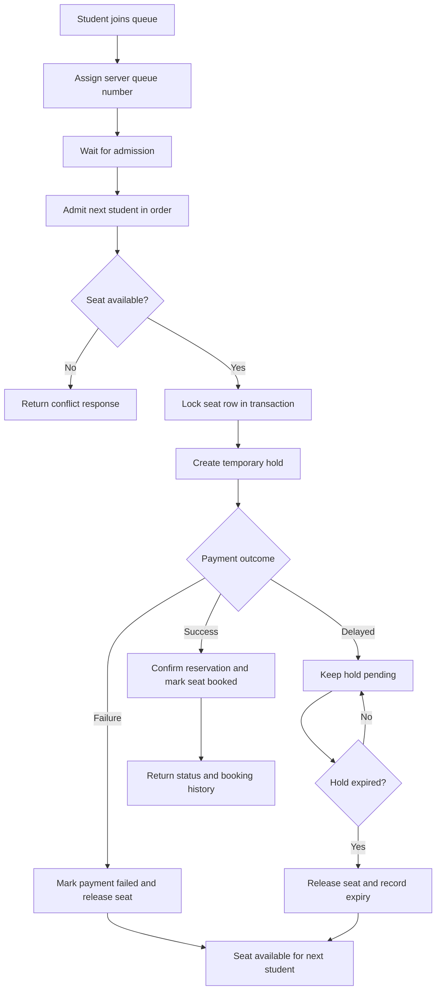

# HoldMySeat booking workflow

The database transaction is the final guard against two requests claiming the same seat. The queue controls admission order; it does not replace database concurrency control.
